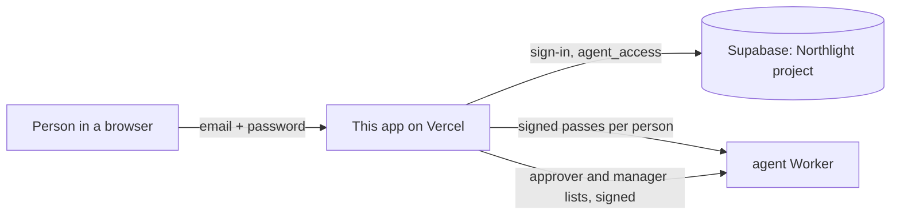

# Northlight console

The staff console for Northlight's AI employees. People at a business sign in with a code Northlight emails them, see what
their AI employees did, decide the requests that wait on them, chat with an employee, and see what it needs and what it
learned. Northlight admins decide who may use, approve and manage each employee.

The employees themselves run in the agent Worker ([`../agent`](../agent)); this app holds no AI and no business data of
its own. Next.js 16 on Vercel, Tailwind 4, Lucide icons, Manrope and Inter type, Supabase for sign-in and the access table.
The demo business is Kestrel Garage, a fictional independent garage (Iris, its website manager and SEO employee).



## Run it on this computer

Everything runs against a fake agent and a fake Supabase, with fake keys only (`scripts/fake.env`):

```bash
npm ci
npm run fake                                         # fake brain + Supabase on 127.0.0.1:54339
node scripts/fake-app.mjs build
node scripts/fake-app.mjs start -p 3310 -H 127.0.0.1  # the app on http://127.0.0.1:3310
```

| Sign in as | Code | Can |
|---|---|---|
| admin@northlight.example | 111111 | Northlight admin: People page, every request; uses, approves and manages Iris |
| alex@kestrel.example | 222222 | Uses, approves and manages Iris |
| jamie@kestrel.example | 333333 | Uses Iris; their requests wait for an admin |
| someone@else.example | 444444 | Signed in, no employee: the no-access page |

A person added on the People page signs in with code 123456. The fake keeps everything in memory; restart it for a clean
world. `FAKE_JOB_STEP_MS` sets how long each step of a chat job takes (default in `scripts/fake-services.mjs`).

Checks: `npm run typecheck`, `npm run lint`, `npm test` (unit tests and the migration on a real Postgres via PGlite).

For the desktop and mobile staff review check, install the browsers with `npx playwright install chromium webkit`, then run `npm run test:e2e`. The test builds the app with fake credentials and starts fresh local services on ports 54346 and 3316.

## Who sees and does what

- **Nobody gets an employee automatically**, Northlight admins included. An admin adds a person on **People** and ticks, per
  employee: **Uses** (chat, see its work), **Approves** (decides that person's own requests) and **Manages** (manager-only
  work, such as Iris submitting copy for review).
- **Requests are private** to the person who asked and to Northlight admins. A request nobody asked for in the app (a scheduled
  check, a phone call) is for admins only. The agent checks the same again when a decision arrives.
- **Chats are private**: each person has their own conversation with each employee (`web-<their id>` in the brain).
- After every change on People, the app sends the business's full approver and manager lists to the agent
  (`PUT /v1/access/approvers`, signed, versioned so a late send never brings back a removed right). When the brain does not
  take them, People says so and offers **Send again**; until then the brain keeps the older lists.

## Settings

Names are in `.env.example`. Per business there are four values; each must equal the agent secret named in
`../agent/clients/<id>/client.json`:

| This app (Vercel) | Agent Worker secret (`client.json` key) | Used for |
|---|---|---|
| `BRAIN_TOKEN_KESTREL` | `CLIENT_TOKEN_KESTREL` (`tokenEnv`) | every call to the brain |
| `BRAIN_USER_SIGNING_KEY_KESTREL` | `USER_SIGNING_KEY_KESTREL` (`userSigningEnv`) | a person's pass: chats, their requests |
| `BRAIN_APPROVER_SIGNING_KEY_KESTREL` | `APPROVER_SIGNING_KEY_KESTREL` (`approverSigningEnv`) | approver and admin passes (decisions) |
| `ACCESS_SIGNING_KEY_KESTREL` | `ACCESS_SIGNING_KEY_KESTREL` (`accessSigningEnv`) | sending the approver and manager lists |

Make each value with `openssl rand -hex 32` (the brain refuses approver keys shorter than 32 characters).

## Going live

1. **Supabase.** Create the Northlight project. Run `supabase/migrations/20261124000000_agent_access.sql` (SQL editor or
   `supabase db push`). Under Authentication:
   - Sign In / Providers: turn **off** "Allow new users to sign up" (People adds accounts through the admin API, which
     still works), keep **Confirm email** on, and leave Email the only provider (no anonymous, phone or social sign-in).
     Northlight admin rights come from the sign-in email in `AGENT_ADMINS`, so nobody may be able to make an account for an
     address they do not own.
   - Passwords: minimum length 10 (`supabase/config.toml` sets this; push it with `npx supabase config push`). People
     sign in with an email and password. Nothing is emailed, so no SMTP set-up is needed.
   - URL configuration: Site URL is the app's address; add `https://<app address>/auth/confirm` to the redirect URLs.
2. **Agent.** Set the four Kestrel Garage secrets above on the agent Worker. `clients/kestrel/client.json` already names
   them and sets `accessSigningEnv`, so app rights come only from the lists this app sends.
3. **Vercel.** Import this repository with `console` as the root directory, Node 22, set every name in `.env.example`
   that you use, add the domain.
4. **First admin.** Put your email in `AGENT_ADMINS`, create your account in Supabase (Authentication, Users, Add user,
   with a password, auto-confirm), sign in, and add the business's people on **People**. Adding a person sets the
   password they sign in with; give it to them yourself. Anyone can change their own under **Change password** in the
   account menu, and an admin can set a new one from Change in a person's row if they forget it.

### Talking to Iris and call history

Optional: the demo runs on web chat alone, and without these settings calls and call history stay hidden.

**Browser calls.** Staff with access to Kestrel Garage's Iris can talk to Iris through their microphone: **Talk to Iris**
on the desk opens `/c/kestrel/iris/talk`. ElevenLabs does the listening and speaking; every answer comes from the agent's
`/v1/chat/completions` as Iris, with the person's own memory, approvals and dashboard. To set it up:

1. Make a free ElevenLabs account and an API key with **ElevenLabs Agents: Write** (everything else: no access).
2. In your own terminal, from `agent/`, set `ELEVENLABS_API_KEY` and run `node scripts/elevenlabs-iris.mjs`. It makes a
   private voice agent that answers from the agent Worker, stores the client token in ElevenLabs as a workspace secret,
   and prints the voice agent's id.
3. Set `IRIS_CALL_HISTORY_KEY` (the key, secret), `IRIS_CALL_AGENT_ID` (the id) and `IRIS_CALL_BROWSER=on`, then
   redeploy.

The voice agent is private: only this app's server can open a call (a one-time token), for a signed-in person who may
use Iris. Each call carries a pass signed for that person (30 minutes), so the agent answers for them alone, and
**Call history** shows a person only the browser calls that carry their own pass. A call ends after 5 minutes.
ElevenLabs' free plan includes 15 minutes of calls a month.

**Phone calls.** To show Iris's phone calls, set the server-only ElevenLabs conversation-read key in `IRIS_CALL_HISTORY_KEY`, the voice
agent's `IRIS_CALL_AGENT_ID` and `IRIS_CALL_BRANCH_ID`, and Iris's line in `IRIS_CALL_LINE` (E.164, with an optional
`IRIS_CALL_LINE_LABEL` for display). Grant the staff member access to Kestrel Garage's Iris. Staff open **Call history**
on Iris's desk.

For each caller, set the server-only `KESTREL_HISTORY_CALLERS` to a JSON array. Each entry needs the person's Supabase `userId`, their confirmed individual phone number in E.164 format (`phone`), and the first UTC Unix second they may view (`since`). Use one number per person. Remove the assignment when access ends. When a handset changes hands, set a new start time for the new user. Calls with an unknown start time are hidden for these assignments.

Example with fictional values:

```json
[{"userId":"00000000-0000-4000-8000-000000000002","phone":"+441632960102","since":1800000000}]
```

## Known limits

- **Password tries** are limited only by Supabase's own rate limits. Every request reaches Supabase from this app's
  server, so Supabase most likely counts those limits per server address rather than per visitor (not tested), and the
  app keeps no count of wrong passwords per address yet.
- **Who has an account** is not in the words of a refused sign-in (a wrong password and an unknown email read the
  same), but the answer's timing may still differ slightly.
- **Forgotten passwords** are reset by an admin on People. There is no emailed reset link, because Supabase's free
  mail only reaches the project's own team.
- **Sending the access lists** is tried up to three times, a second or so apart. If the brain still does not take them,
  People shows it and offers Send again, and the brain keeps its older lists. This app checks every decision against
  the current access itself. For a person whose access changed anywhere in the business, it starts no new job and
  decides none of their requests (a decision resumes their job) until the brain has taken the change; each try sends the
  lists again first. A job that was already running, or a message already waiting behind it, still finishes under the
  brain's older lists, and so does one that starts in the moment between this check and a later change. A list the
  brain skips because it holds a newer version counts as not delivered.
- **One sender per business.** The brain keeps whichever access list has the higher version. If another app or
  environment sends lists for the same business with the same key after this app's list was taken, its list wins
  unnoticed until this app's next change is refused as older. Give each environment its own business keys.
- **Deleting an account in Supabase** removes its access here but not from the brain's lists until the next change on
  People. The deleted account cannot sign in, so nothing reaches the brain under it.
- The Content-Security-Policy covers framing, plugins, `<base>` and form targets; it has no `script-src` yet.

## Layout of the code

- `src/app`: pages (`/sign-in`, team `/c/<business>`, desk `/c/<business>/<employee>`, `/people`), server actions and the
  chat's API routes.
- `src/lib/access.ts`, `src/lib/requests.ts`: who may see and do what, pure and tested.
- `src/lib/server`: Supabase, the brain client (`brain.ts`), passes (`../pass.ts`), People (`people.ts`).
- `src/components`: the Northlight mark (north star), the orbit, the desk, the chat, the People page, and the small UI kit in `ui/`.
- `scripts/fake-*.mjs`: the fake brain and Supabase used above. `PRODUCT.md` and `DESIGN.md` hold the product and design
  decisions.
